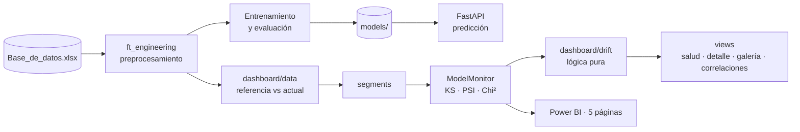

<p align="center"></p>

<h1 align="center">Credit Risk Monitor</h1>

<p align="center"><b>Preparation, evaluation and monitoring of a credit-risk model.</b></p>

<p align="center"></p>

<p align="center">
     
</p>

<p align="center"><a href="https://dodysalim.github.io/"><b>🌐 Portfolio</b></a> · <a href="README.md"><b>🇪🇸 Versión en español</b></a></p>

---

## 📌 At a glance

| | |
| --- | --- |
| **🎯 Problem** | Evaluate an on-time payment model and detect data drift. |
| **🛠️ Solution** | MLOps pipeline: preprocessing, training, prediction API and drift monitoring (KS, PSI, Chi²). |
| **📈 Deliverables** | Local FastAPI service, modular monitoring dashboard and a 5-page Power BI report. |
| **🧪 Quality** | 26 automated tests; drift logic implemented as pure, testable functions. |

## 🏗️ Architecture



## 🚀 How to run

```bash
pip install -r requirements.txt
python -m streamlit run mlops_pipeline/src/app.py
python -m uvicorn mlops_pipeline.src.model_deploy:app --port 8080
python -m pytest tests -q
```

## ⚖️ Scope

The 'current' dataset is the holdout split, not production data.

---

<p align="center">
<b>Dody Dueñas Remache</b> · Data Analyst / Data Scientist · Guayaquil, Ecuador (remote LATAM)<br>
<a href="https://dodysalim.github.io/">Portfolio</a> · <a href="https://github.com/dodysalim">GitHub</a> · <a href="https://www.linkedin.com/in/dody-duenas/">LinkedIn</a> · <a href="mailto:dodydurema67@gmail.com">dodydurema67@gmail.com</a>
</p>
