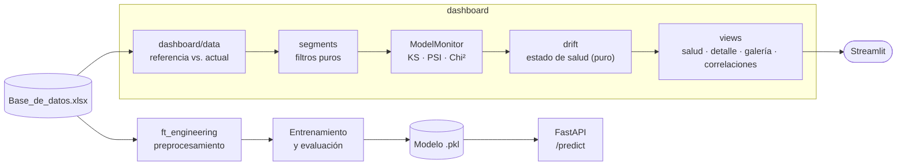

<p align="center"></p>

<h1 align="center">Credit Risk Monitor</h1>

<p align="center"><b>Preparación, evaluación y monitoreo de un modelo de riesgo crediticio.</b></p>

<p align="center">

</p>

<p align="center">
     
</p>

<p align="center">
<a href="https://github.com/dodysalim/Proyecto_Integrador_M5/actions"></a>  
</p>

<p align="center"><a href="https://dodysalim.github.io/"><b>🌐 Portafolio</b></a> · <a href="docs/PORTFOLIO_CASE.md"><b>📄 Caso de estudio</b></a> · <a href="docs/VALIDATION.md"><b>✅ Verificación</b></a> · <a href="README.en.md"><b>🇺🇸 English</b></a></p>

---

## 📌 Resumen en 30 segundos

| | |
| --- | --- |
| **🎯 Problema** | Evaluar un modelo de pago a tiempo y detectar cambios en los datos (data drift). |
| **🛠️ Solución** | Pipeline MLOps: preprocesamiento, entrenamiento, API de predicción y monitoreo con KS, PSI y chi-cuadrado. |
| **📈 Entregables** | API local con FastAPI, dashboard de monitoreo y Power BI de 5 páginas. |
| **🧪 Calidad** | 26 pruebas automatizadas (lógica, API y dashboard); dashboard modular con principios SOLID. |
| **👤 Autor** | Dody Dueñas Remache. |

## ❓ La pregunta de negocio

¿Cómo evaluar una clasificación de crédito y detectar cambios en los datos sin confundir monitoreo con validación en producción?

## ✨ Qué incluye

- Preprocesamiento y entrenamiento de clasificadores.
- API local de predicción y dashboard de monitoreo de distribuciones.
- KS, PSI, chi-cuadrado y divergencias; Power BI de cinco páginas.

## 🚀 Cómo ejecutarlo

Usa Python 3.11 o 3.12 en un entorno independiente. Desde la raíz:

```bash
python -m venv .venv
# Windows: .venv\Scripts\activate
# macOS/Linux: source .venv/bin/activate
python -m pip install -r requirements.txt
```

Después de configurar los datos:

```bash
python -m streamlit run mlops_pipeline/src/app.py
# API local (requiere artefactos compatibles):
python -m uvicorn mlops_pipeline.src.model_deploy:app --host 127.0.0.1 --port 8080
```

## 🗂️ Datos y configuración

Base académica y componentes locales presentes. Se excluye puntaje por fuga de información. Pago_atiempo=1 significa paga a tiempo; no invertir la interpretación del riesgo.

## 📊 Power BI · PC y móvil

[Archivos e instrucciones](powerbi/README.md). Descarga el repositorio completo y abre `powerbi/Abrir-PowerBI.bat` en Windows; después pulsa **Actualizar**. Incluye A4 horizontal a tamaño real (100 %) y diseño móvil vertical. El archivo `.pbip` necesita sus carpetas Report, SemanticModel y data.

## 🏗️ Arquitectura



## 🧭 Estructura del repositorio

| Ruta | Qué contiene |
| --- | --- |
| [mlops_pipeline/src/](mlops_pipeline/src/) | Preparación, entrenamiento, API y monitoreo |
| [mlops_pipeline/src/dashboard/](mlops_pipeline/src/dashboard/) | Dashboard por capas: datos, segmentos, drift (lógica pura), gráficos y vistas |
| [tests/](tests/) | Pruebas de lógica y API |
| [requirements.txt](requirements.txt) | Dependencias |

## ✅ Calidad y alcance

26 pruebas aprobadas, incluidas 12 de la lógica del dashboard. Dashboard de monitoreo abrió sin excepciones con la base disponible.

El conjunto Actual de Power BI es el holdout, no datos de producción. Las métricas de drift precalculadas no se recalculan al filtrar clientes. El modelo requiere validación adicional para un uso operativo.

Para repetir las pruebas desde la raíz:

```bash
python -m pytest tests -q
```

## 👥 Autoría

Proyecto académico Henry M5. Dody Salim Dueñas Remache.

[Documentación anterior](docs/ORIGINAL_README.md), conservada como referencia histórica.

---

<p align="center">
<b>Dody Dueñas Remache</b> · Analista de Datos / Data Scientist<br>
<a href="https://dodysalim.github.io/">Portafolio</a> · <a href="https://github.com/dodysalim">GitHub</a> · <a href="https://www.linkedin.com/in/dody-duenas/">LinkedIn</a> · <a href="mailto:dodydurema67@gmail.com">dodydurema67@gmail.com</a>
</p>
